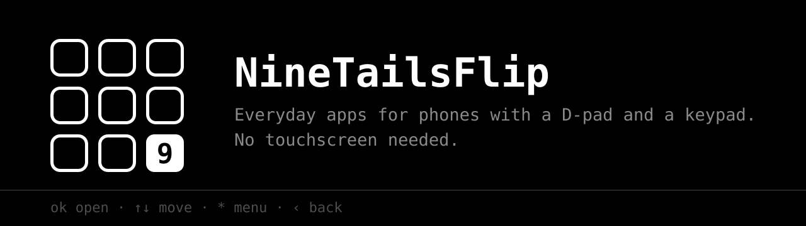

  

We make everyday Android apps work on **phones with a D-pad and a number pad instead of a
touchscreen**. That means a messenger, a gallery, and the other things you reach for every day,
each one rebuilt so that every action is a key press away.

## Apps

| | App | What it is | Release |
|---|---|---|---|
| 💬 | **[TG9](https://github.com/NineTailsFlip/tg9)** | Telegram on 9 keys, an unofficial client built on [TDLib](https://github.com/tdlib/td): chats, voice messages, photos and videos, notifications without Google push | [0.1.3](https://github.com/NineTailsFlip/tg9/releases/latest) |
| 🖼 | **[G9](https://github.com/NineTailsFlip/g9)** | Gallery: photos and videos by day and by folder, zoom, video playback, share, trash | [0.1.1](https://github.com/NineTailsFlip/g9/releases/latest) |
| ⌨️ | **[K9](https://github.com/NineTailsFlip/k9)** | Keyboard: T9 in 50+ languages, a fork of [Traditional T9](https://github.com/sspanak/tt9) with its settings in the Nine look | [66.0](https://github.com/NineTailsFlip/k9/releases/latest) |

### The Nine suite, forked

Our forks of Timo Furrer's [Nine](https://nine.furrer.life) apps. Each keeps upstream's full
history, merges upstream with one script, and updates itself from our releases.

| | App | What it is | Release |
|---|---|---|---|
| 🏠 | **[L9](https://github.com/NineTailsFlip/l9)** | Launcher: the number keys launch your apps; recent apps | [0.11.0](https://github.com/NineTailsFlip/l9/releases/latest) |
| 📅 | **[C9](https://github.com/NineTailsFlip/c9)** | Calendars and contacts | [0.6.2](https://github.com/NineTailsFlip/c9/releases/latest) |
| 📞 | **[P9](https://github.com/NineTailsFlip/p9)** | Phone: the dialer and calls | [0.3.4](https://github.com/NineTailsFlip/p9/releases/latest) |
| ✉️ | **[M9](https://github.com/NineTailsFlip/m9)** | Messages: SMS conversations | [0.2.4](https://github.com/NineTailsFlip/m9/releases/latest) |

### Our LineageOS

A LineageOS 23.2 (Android 16) build for the ALT AT-M140 keypad flip phone
([android_vendor_thor2](https://github.com/kloploid/android_vendor_thor2)), with all the apps
above built in and the system's own screens redone in the same style:

| | App | What it is |
|---|---|---|
| 👋 | **[Setup](https://github.com/NineTailsFlip/setup9)** | The first-time setup: language, Wi-Fi, keyboard layouts, date and time, PIN, the look of every app |
| ⚙️ | **[Settings](https://github.com/NineTailsFlip/settings9)** | The phone's settings |
| 🔒 | **[Lock](https://github.com/NineTailsFlip/lock9)** | The lock screen |

### Shared code

| | Repository | What it is |
|---|---|---|
| 🧩 | **[nine-core](https://github.com/NineTailsFlip/nine-core)** | The Nine suite's `core` and `contacts` modules, our gallery kit, and updates from GitHub Releases |

Install an app by downloading its APK from Releases; after that it offers its own updates. The
official Nine builds are on [Nine's F-Droid repository](https://nine.furrer.life).

## How our apps feel

- **Keys first, always.** Up/Down move, OK acts, Back goes back. `*` opens a numbered menu where
  a digit picks an item, and `#` does the obvious second thing. Nothing needs a tap or a swipe.
- **One column of plain text on black.** It is easy to read on a 2.4″ screen. A dim hint bar at
  the bottom always says which keys matter right now.
- **The phone's own T9** for typing, never an on-screen keyboard.
- **Light on the phone.** Downloads are small and big files ask first. No Google Play Services
  are required, and nothing is shared unless you ask for it.
- **The same keys in every app**, so learning one means knowing all of them.

## Phones

Android 14 or newer with a D-pad, an OK key and a number pad. Our apps run without a
touchscreen and without Google services.

## Built on

- **[Nine](https://git.sr.ht/~timofurrer/nine)** by Timo Furrer (L9, C9, P9, M9): the keypad UI
  our apps share and the apps we fork, used under GPL-3.0. Our apps are GPL-3.0-or-later too.
- **[Traditional T9](https://github.com/sspanak/tt9)** by sspanak and contributors, which K9 is
  built on (Apache-2.0).
- **[LineageOS](https://lineageos.org)**, which our phone build is based on.
- **[TDLib](https://github.com/tdlib/td)**, Telegram's own client library. TG9 is not made by
  Telegram and is not affiliated with it.

## Get involved

- **Something broken?** Open an issue in that app's repository. The form asks for your phone
  model, because keypads differ.
- **Want an everyday app adapted for keys?**
  [Request it here](https://github.com/NineTailsFlip/.github/issues/new?template=app_request.yml).
- **Want to code?** Read [CONTRIBUTING](https://github.com/NineTailsFlip/.github/blob/main/CONTRIBUTING.md).
